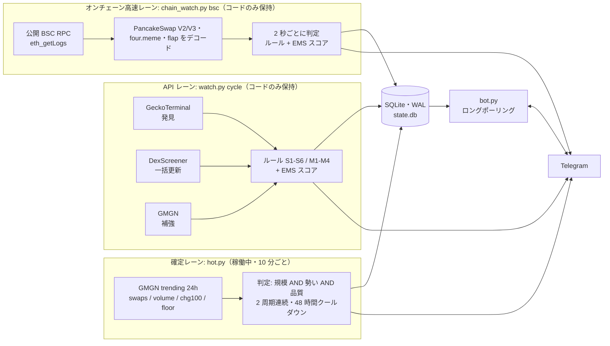

**[English](README.md) | [日本語](README.ja.md)**

# pump-watch

BSC のミームトークンを監視し、はっきり盛り上がった銘柄を Telegram に通知するツール。1 日 1 回、その日に確定した銘柄のまとめも送る。
監視と通知だけを行う。売買はせず、トランザクションに署名もせず、ウォレットの鍵も持たない。

Python 3.9 以上・標準ライブラリのみ（`requirements.txt` は不要）。コードは Python 約 8,300 行、ユニットテストは 508 件。

## 何をするか

- 10 分ごとに GMGN の trending 24h を 4 とおりの並びで取得し、観測を SQLite に保存して、規模・勢い・品質で全銘柄を判定する。
- 2 周期連続で通過した銘柄を「確定」とし、出来高・取引数・保有者数・ピーク時価総額・その日の値動き・売買した有名ウォレットを載せた通知を 1 通送る。
- 23:00 JST に日次まとめを送る（前回のまとめ以降の確定・前日から続いている銘柄・惜しかった銘柄）。
- Telegram bot がコマンド（`/status`・`/hot`・`/score`・`/timeline` など）に答え、ボタンや `/set` でしきい値を変えられる。
- より速い検出レーン 2 本（API ポーリングのレーンと BSC オンチェーンのレーン）もテスト付きで同梱している。実際に動いているものは[構成](#構成)を参照。

## 難しいところ

- **誤検出と取りこぼしのバランス。** 本物の急騰を表す数字は、1 回だけ価格表示が崩れたステーブルコイン、価格は横ばいで保有者だけ増え続ける大型銘柄、出来高の大半が回転売買の銘柄にも同じように現れる。ある種類の誤検出を消すルールは本物も落としうるので、変更のたびに保存済みの観測を再生し、確定の集合を変更前後で比べた。
- **無料 API のレート制限。** GeckoTerminal は公称の上限よりずっと手前で 429 を返し、DexScreener は 1 分 300 コール、GMGN の無料枠は約 35 秒に 1 コールずつしか補充されない。複数のプロセスが同じ枠を使うため、残量はプロセス単位ではなくプロセスをまたいで数える必要がある。
- **書き手が複数いる SQLite。** 最大 3 レーンと bot が 1 つの SQLite ファイルを共有する。ネットワーク待ちのあいだ書き込みトランザクションを握るだけで、負荷時に `database is locked` が出た。

## 構成



現在スケジュール実行しているのは確定レーン（`hot.py cycle` と `hot.py digest`）と Telegram bot だけ。API レーンとオンチェーン高速レーンは開発中に稼働させていたもので、テストとともにリポジトリに残しているが、今は動かしていない。

| パス | 役割 |
| --- | --- |
| `hot.py` | 確定レーン。取得・観測の保存・判定・確定・通知・日次まとめ |
| `watch.py` | API レーン、設定の読み書き、通知本文の組み立て、bot コマンドの処理、CLI |
| `chain_watch.py`, `chain/` | オンチェーンレーン。RPC クライアント・ログのデコード・銘柄ごとの集計・4 スレッドの常駐本体 |
| `rules.py`, `baseline.py` | 固定しきい値のルールと EMS スコア（純関数）、平常値 |
| `sources/` | GMGN・DexScreener・GeckoTerminal・GoPlus・four.meme のアダプタ |
| `db.py` | SQLite のスキーマ・マイグレーション・クエリ |
| `enrich.py`, `score_log.py` | 通知用のロゴと安全確認、採点ログ |
| `bot.py`, `notify.py` | Telegram bot（ボタン・コマンド）と Bot API クライアント |
| `gm.py` | `gmgn` CLI を呼び、429 のときは待って撃ち直すラッパー |
| `docs/scoring.ja.md` | EMS スコアの設計メモ |

## 検出ロジック

### 確定レーン（hot.py）

各周期で GMGN の trending 24h を 4 とおり（取引数順・出来高順・+100% 以上・「floor」）取り、和集合をとる。floor は規模の最も緩い下限で絞った出来高順の取得で、上位 100 件の枠からこぼれる中堅銘柄を拾うためのもの。判定は `ok = 規模 AND 勢い AND 品質`。

| 要素 | 条件（既定値） |
| --- | --- |
| 規模 | 取引数 3,000 以上・24h 出来高 $300K 以上・保有者 300 以上・その日のピーク時価総額 $100K 以上。保有者 1,000 以上なら取引数は 1,500 以上で足りる。それに加えピークが $300K 以上なら出来高は $150K 以上で足りる。 |
| 勢い（いずれか 1 つ） | 24h 変化率 +100% 以上／取引数 30,000 以上かつ 24h +20% 以上／JST のその日の runup（その時点までの安値からその後の価格への倍率）2.0 倍以上かつ 24h 変化率 0 以上／その日の最初の観測からの保有者増加が +300 人以上かつ +20% 以上で、24h +20% 以上 |
| 横ばいの打ち消し | 自前観測の直近 24h が横ばい（12 時間以上にわたる 6 点以上で 最高値÷最安値 < 1.05）なら勢いなしとする。その前に「行って戻る」一時的な安値（前後が 10% 以内で一致し、その低い方の 0.6 倍未満が最大 6 点・2 時間以内）を外れ値として除く。 |
| 品質 | 回転売買でもハニーポットでもない |

2 周期連続で通過したら確定。プールに現れなかった周期があれば連続は 0 に戻る。通知した銘柄は 48 時間は再確定しない。`hot_hits` は銘柄ごと・JST の日ごとに最大 1 行。何倍になったかは本文に出すだけで、判定には使わない。

### EMS スコア（API レーンとオンチェーンレーン）

速い 2 レーンは固定しきい値ではなく、その銘柄自身の平常値からの外れで採点する。

```
EMS = 30*c_vol + 25*c_buyers + 20*c_flow + 10*c_accel + 10*c_wallet + 5*c_price - ペナルティ   （0〜100 に収める）
```

- `c_vol`: 買い出来高の対数の頑健 z 値（平常値の中央値と MAD）を 4 で割ったもの。
- `c_buyers`: 買い手のユニーク数の、期待値に対するポアソン尤度比 `G = sqrt(2*(k*ln(k/mu) - (k - mu)))` を 4.3 で割ったもの。
- `c_flow`: `0.7*clip(純買い / (0.02*流動性)) + 0.3*max(BSI, 0)`。four.meme の卒業前は流動性の代わりにボンディングカーブの必要額を使う。
- `c_accel`: 30 秒窓の `G` の前回からの増分。`c_wallet`: 直近 10 分の名簿ウォレットの買いと、30 分前からのスマートマネー数・保有者数・閲覧数の急増。`c_price`: 2 分間の価格変化。時価総額に対して流動性が薄いほど重みを下げる。
- 平常値は、その銘柄の直近 15 分と 24 時間（厳しい方）、チェーン全体の下限、生後 60 分未満の銘柄は発射台と生後分数が同じ銘柄のコホートから作る。市場全体が沸いているときは `0.5*max(z_market, 0)` をすべての z と G から差し引く。
- 最低証拠: 30 秒で 3 人以上か 120 秒で 5 人以上の買い手がいないと、買い手と加速の項は 0。流動性の足切りは $20K（生後 60 分未満は $10K）。
- ペナルティ: 同じウォレットの買い繰り返し 15、1 ウォレットが買いの 50% 超 10、バンドル 10、回転売買 20、往復売買 10、価格下落中に売りが買い以上 10。ハニーポットは 0 点。
- レベル: WATCH 60・HOT 70・STRONG 80・EXTREME 90。レベルが上がったら即通知。同じレベルでは、そのレベルのクールダウン（30 / 60 / 120 / 360 分）が明け、かつ前回通知時より 5 点以上高いときだけ再通知。レベルが下がっても通知しない。通数の上限は設けず、多すぎる場合は検出条件の側で絞る。

旧来の固定しきい値ルール（S1〜S6 の急増、M1〜M4 の到達）も評価と記録は続けており、送るかどうかは `notify.legacy` で切り替える。

## 開発で直した問題

再生の数字は、記載の期間に SQLite へ保存した観測を、変更前と変更後のルールで判定し直したもの。

| 日付（2026） | 問題 | 対処 | 結果・確認 |
| --- | --- | --- | --- |
| 10-01 | 1 回の誤った価格表示で値幅 8 倍となったステーブルコイン（DAI）が確定した。本物の 4 銘柄は上位 100 件のどの並びにも入らず取りこぼした。 | 規模の下限で絞った floor の取得を追加。外れ値の安値を除いたうえで直近 24h が横ばいなら勢いを打ち消す。 | 09-20〜10-01 の再生で確定 265 件 → 264 件（外れたのは DAI のみ、ほかは確定時刻も不変）。取りこぼしていた銘柄を拾えた。 |
| 09-25 | 回転売買の小型銘柄が出来高だけで通っていた（例: ピーク時価総額 $51K に対し出来高 $2.3M）。 | その日のピーク時価総額の下限と、保有者が多くピークも大きい銘柄向けの出来高の代替経路を追加。 | 再生で確定 174 件 → 127 件。 |
| 09-24 | 日次まとめを JST の日付で切っていたため、23:00 のまとめの後に確定した 17 件がどのまとめにも載らなかった。 | 前回のまとめに載せた確定の最大 id より後を拾う方式に変更し、起点は送信に成功したときだけ進める。 | まとめの後と、まとめの送信中に確定した場合のテストを追加。 |
| 09-24 | 保有者増加で確定した 36 件のうち 28 件が価格横ばいの大型銘柄、値幅で確定した 18 件のうち 15 件が暴落（高値 → 安値）だった。 | 保有者増加には伸び率 +20% と 24h +20% を必須にし、値幅を runup（安値 → その後の高値）に再定義。 | `test_holder_growth_needs_rise`・`test_crash_is_not_day_range`。 |
| 09-19 | レーン間で `database is locked`。3 か所がネットワーク待ちのあいだ書き込みトランザクションを握っていた。 | ネットワーク呼び出しをトランザクションの外へ出し、Telegram 送信は COMMIT の後に行う。 | 構造で担保（`chain/run.py` の `judge_token`）。並行性の専用テストは無い。 |
| 09-18 | 平均では 1 分 300 コール未満なのに DexScreener の 429 が波状に出た。 | 60 秒の移動窓で 1 分 270 コール（高速レーンのぶんを残す）を上限とし、前回からの経過時間に比例して撃つ。 | `test_watch.py` に窓の上限とペース配分のテスト。 |
| 09-18 | GoPlus は知らない銘柄にも「チェーン未対応」と同じ空の結果を返すため、未知の銘柄 1 件で BSC 全体の安全確認が止まった。 | そのチェーンで一度も結果が取れていない場合だけ未対応とみなす（`has_security`）。 | `test_an_unknown_token_does_not_disable_the_whole_chain`。 |
| 09-19 | 通数の上限が判定 9,027 件（90 点以上の 57 銘柄を含む）を黙って捨てていた。 | 上限を撤去し、検出条件を締めて通知を減らす方針に変更。 | `test_there_is_no_cap_on_the_number_of_alerts`。 |

## 信頼性

- **429 への多層の対処。** `gm.py` は GMGN のエラー文から待ち時間を読んで再試行する（最大 8 回）。`hot.py` は GMGN の呼び出しを 12 秒間隔に空け、失敗したら 60 秒後に 1 回だけやり直す。すべてのプロセスの GMGN 呼び出しは `api_calls` 表に記録され、API レーンと補強処理は直近 210 秒の呼び出し数を 1 つの共有枠として数え、通知時の取得ぶんを残して早めに引く。DexScreener は 1 分 270 コールの移動窓、GeckoTerminal は分単位の予算と 429 後の一時停止、Telegram は `retry_after` だけ待って 1 回再送する。公開 RPC は失敗したら次のプロバイダへ回り、429 が多いものは最後の予備に置く。
- **SQLite。** WAL モード・`synchronous=NORMAL`。オンチェーンレーンの判定は `events` を読む前に `BEGIN IMMEDIATE` を取るので、2 レーンが同じ通知を二重に撃たない。Telegram 送信は `COMMIT` の後なので、ネットワーク待ちのあいだロックを握らない。常駐の接続は自動コミット。
- **冪等性。** 確定は `UNIQUE(chain, address, day_jst)` の `hot_hits` への `INSERT OR IGNORE` なので、周期が重なったり繰り返されたりしても同じ銘柄に同じ日 2 通は送らない。日次まとめの起点（`hot.last_digest_id`）は実際に送れたときだけ進む。
- **認証情報。** bot のトークンは実行時に環境変数か macOS の Keychain から読み、エラー文に混ざった場合は伏せる。bot は設定したチャット以外からのメッセージを無視する。

## Telegram bot のコマンド

| コマンド | 内容 |
| --- | --- |
| `/status` | 各レーンの生存・送信 ON/OFF・当日の通数 |
| `/hot` | 今日の確定・継続・惜しい銘柄 |
| `/score [件数]` | 直近 10 分の EMS 上位（既定 10 件） |
| `/timeline <アドレス>`（`/tl`） | その銘柄に送った通知の履歴 |
| `/mark <アドレス> [メモ]` | 較正用に手動のラベルを残す |
| `/marks` | 最近の /mark を 20 件 |
| `/near [時間]` | 発火しかけた銘柄（既定 6 時間） |
| `/config` | 現在のしきい値 |
| `/set <キー> <値>` | しきい値を変更（例: `/set hot.size.swaps 2500`） |
| `/chains` | 対象チェーンをボタンで選ぶ（`/chains bsc` でも可） |
| `/dryrun` | 送信 ON/OFF をボタンで切り替え（`/dryrun on`・`/dryrun off` でも可） |
| `/menu`, `/help` | ボタンとコマンド一覧 |

通知本文と bot の UI は日本語。

## テスト

```sh
python3 -m unittest discover -s . -p 'test_*.py'
```

8 ファイル・508 件（約 5,600 行）。ネットワークと `gmgn` のサブプロセスはすべて偽物に差し替えている。ソケットとサブプロセスを塞いだ状態でも全件を流し、外部への呼び出しが無いことを確かめた。SQLite のテストはメモリ上か一時ファイルの DB を使う。`fixtures/goplus_flapguy.json` は実際の GoPlus の応答で、保有者・作成者・プールのアドレスだけをダミーに置き換えている。

## セットアップ

macOS を主な対象とする（秘密情報は Keychain、定期実行は launchd）。Linux でも環境変数と cron / systemd で動く。

1. **Python 3.9 以上。** 追加で入れるパッケージは無い。
2. **GMGN へのアクセス。** 確定レーンと補強処理は `PATH` 上の `gmgn` という実行ファイル（GMGN の `gmgn-cli` のラッパー）を `market trending --chain bsc --interval 24h --limit 100 --raw` のような引数で呼び、標準出力の JSON を読む。API キーはラッパーが `GMGN_API_KEY` から読む。pump-watch 自身はキーを読まない。`run.sh` は `~/.local/bin` を `PATH` に足す。
3. **設定。** `cp config.example.json config.json` して編集する。`config.json` が無ければ例を読み、最初の `hot` 実行で `config.json` が作られる。例は `"dry_run": true` で、通知を送らずに標準出力へ出す。日次まとめはドライランでも送る。
4. **Telegram。** @BotFather で bot を作り、その bot に `/start` を送る。
   - macOS: `security add-generic-password -U -s TELEGRAM_BOT_TOKEN -a shared -w` の後に `./run.sh setup`。チャット ID を見つけて Keychain に `TELEGRAM_CHAT_ID` として保存し、テスト通知を送る。
   - Linux や CI: `PUMPWATCH_TG_TOKEN` と `PUMPWATCH_TG_CHAT_ID` を設定する。環境変数は Keychain より優先される。
5. **名簿（任意）。** `cp wallets.example.txt wallets.txt` して、売買を通知に載せたいウォレットを並べる。
6. **手で 1 回動かす。** `./run.sh hot cycle`、続けて `./run.sh hot digest`。
7. **定期実行。** `deploy/` に launchd ジョブの例がある: `com.example.pumpwatch.hot`（10 分ごと）・`.digest`（23:00）・`.bot`（常駐）。`/path/to/...` を書き換え、ログのディレクトリを作り、`~/Library/LaunchAgents/` に置いて `launchctl bootstrap gui/$(id -u) <plist>` で読み込む。Linux では `run.sh hot cycle` と `run.sh hot digest` を cron に、`run.sh bot` を systemd のサービスにする。bot は 1 つだけ動かすこと（Telegram の `getUpdates` は消費者を 1 つしか許さない）。

ほかの入口: `./run.sh cycle`（API レーンを 1 周期）、`python3 chain_watch.py bsc`（オンチェーンレーン）、`./run.sh hot judge`（保存済みの観測を API を呼ばずに判定し直す）。

## 設定

| 項目 | 置き場所 | 補足 |
| --- | --- | --- |
| しきい値とスイッチ | `config.json`（ひな形は `config.example.json`） | 確定レーンは `hot.*`、EMS は `score.*`、旧ルールは `s1`〜`s6` / `m1`〜`m4`、ほかに `chains`・`dry_run`。Telegram の `/set` でも変えられる。 |
| Telegram のトークン / チャット ID | `PUMPWATCH_TG_TOKEN`・`PUMPWATCH_TG_CHAT_ID`、または Keychain の `TELEGRAM_BOT_TOKEN`・`TELEGRAM_CHAT_ID`（account は `shared`） | 環境変数を先に見る。 |
| GMGN のキー | `GMGN_API_KEY` | `gmgn` ラッパーが読む。pump-watch は読まない。 |
| 状態ディレクトリ | `PUMPWATCH_STATE_DIR`（既定 `~/.local/state/pump-watch`） | ロゴのキャッシュと採点ログ（`logs/pump-score-YYYYMMDD.jsonl`）。 |
| データベース | コードと同じ場所の `state.db` | git 管理外。 |
| 名簿 | `wallets.txt`（`score.wallets_file`） | 1 行に `0xアドレス # 名前 \| @ハンドル`。git 管理外。 |

## 制約

- シグナルは経験則にすぎない。誤検出も取りこぼしも起きるし、確定はその後の値動きを何も保証しない。投資助言ではない。
- 確定レーンは CLI ラッパー経由の GMGN の trending データに依存する。わざと遅くしてある（10 分周期・2 周期連続で確定）ので、知らせるのは「すでに盛り上がった銘柄」であって初動ではない。
- 実際に使っているのは BSC だけ。オンチェーンレーンは BSC（PancakeSwap V2/V3・four.meme・flap）専用。コード中のほかのチェーンは検証が薄い。
- API レーンとオンチェーンレーンは今は動かしていないため、現在の API や RPC エンドポイントに対する挙動は最近確かめていない。
- 日付の区切りは JST、通知は日本語。
- `./run.sh setup` は macOS の Keychain を使う。ほかの OS では環境変数を直接設定する。
- SQLite のため、動かせるのは 1 台のホストに限られる。

## ライセンス

MIT。[LICENSE](LICENSE) を参照。
