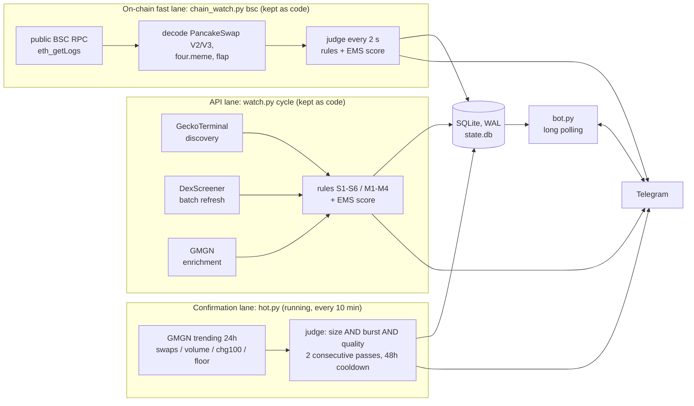

**[English](README.md) | [日本語](README.ja.md)**

# pump-watch

pump-watch watches BSC meme tokens and sends a Telegram message when a token is clearly taking off, and a daily digest of the day's confirmed movers.
It only monitors and notifies: it does not trade, does not sign transactions, and holds no wallet keys.

Python 3.9+, standard library only (no `requirements.txt` is needed). About 8,300 lines of Python plus 508 unit tests.

## What it does

- Every 10 minutes it makes four pulls of GMGN's 24h trending list, stores each observation in SQLite, and judges every token on size, momentum and quality.
- A token that passes two cycles in a row is "confirmed" and gets one Telegram message with volume, swaps, holders, peak market cap, the day's price path and the notable wallets that traded it.
- At 23:00 JST it sends a digest: confirmed tokens since the previous digest, tokens still running from earlier, and near misses.
- A Telegram bot answers commands (`/status`, `/hot`, `/score`, `/timeline`, ...) and lets you change thresholds with buttons or `/set`.
- Two faster detection lanes (an API polling lane and an on-chain BSC lane) are included with their tests. See [Architecture](#architecture) for what is actually running.

## Why it is hard

- **False positives against misses.** The same numbers that describe a real breakout also describe a stablecoin with one bad price print, a large cap with flat price and steady holder growth, or a token whose volume is mostly wash trading. Each rule that removes one class of false positive can drop real movers, so every change was checked by replaying stored observations and comparing the confirmed set before and after.
- **Free-API rate limits.** GeckoTerminal starts returning 429 well below its published limit, DexScreener allows 300 calls per minute, and GMGN's free tier refills roughly one call every 35 seconds. Several processes share these budgets, so the budget has to be tracked across processes, not per process.
- **SQLite with several writers.** Up to three lanes and the bot share one SQLite file. Holding a write transaction while waiting on the network was enough to produce `database is locked` under load.

## Architecture



Only the confirmation lane (`hot.py cycle` and `hot.py digest`) and the Telegram bot are currently scheduled. The API lane and the on-chain fast lane ran during development; they are kept in the repository with their tests but are not running now.

| Path | Role |
| --- | --- |
| `hot.py` | Confirmation lane: fetch, store observations, judge, confirm, notify, daily digest |
| `watch.py` | API lane, config handling, message formatting, bot command dispatch, CLI |
| `chain_watch.py`, `chain/` | On-chain lane: RPC client, log decoding, per-token aggregation, 4-thread runner |
| `rules.py`, `baseline.py` | Fixed-threshold rules and the EMS score (pure functions), baselines |
| `sources/` | Adapters for GMGN, DexScreener, GeckoTerminal, GoPlus, four.meme |
| `db.py` | SQLite schema, migrations and queries |
| `enrich.py`, `score_log.py` | Logos and security checks for messages; score logging |
| `bot.py`, `notify.py` | Telegram bot (buttons, commands) and the Bot API client |
| `gm.py` | Wrapper that calls the `gmgn` CLI and waits on 429 |
| `docs/scoring.ja.md` | Design notes for the EMS score (Japanese) |

## Detection logic

### Confirmation lane (hot.py)

Each cycle takes the union of four GMGN trending 24h pulls (by swaps, by volume, +100% movers, and a "floor" pull filtered by the loosest size limits so mid-sized tokens are not cut off by the top-100 limit). A token is judged with `ok = size AND burst AND quality`.

| Part | Condition (defaults) |
| --- | --- |
| Size | swaps >= 3,000, 24h volume >= $300K, holders >= 300, and the day's peak market cap >= $100K. With holders >= 1,000, swaps >= 1,500 is enough. With that plus a peak >= $300K, volume >= $150K is enough. |
| Burst (any one) | 24h change >= +100%; or swaps >= 30,000 with 24h change >= +20%; or a runup (lowest price so far to a later price) of 2.0x within the JST day with 24h change >= 0; or holder growth since the first observation of the day of >= +300 and >= +20%, with 24h change >= +20% |
| Flat override | If the last 24h of own observations are flat (at least 6 points over at least 12 hours, max / min < 1.05), there is no burst. Short "go and return" glitch lows (up to 6 points below 0.6x of both neighbours, which agree within 10%, within 2 hours) are excluded first. |
| Quality | not flagged as wash trading and not a honeypot |

A token is confirmed after 2 consecutive passing cycles. A cycle where the token is missing from the pool resets the streak. After a notification the same token is not confirmed again for 48 hours, and `hot_hits` holds at most one row per token per JST day. The price multiple is shown in the message but is not used to decide.

### EMS score (API lane and on-chain lane)

The faster lanes score tokens against their own baseline instead of fixed thresholds:

```
EMS = 30*c_vol + 25*c_buyers + 20*c_flow + 10*c_accel + 10*c_wallet + 5*c_price - penalties   (clamped to 0..100)
```

- `c_vol`: robust z-score of log buy volume against the token's baseline (median and MAD), divided by 4.
- `c_buyers`: Poisson likelihood ratio of unique buyers against the expected count, `G = sqrt(2*(k*ln(k/mu) - (k - mu)))`, divided by 4.3.
- `c_flow`: `0.7*clip(net_buy / (0.02*liquidity)) + 0.3*max(BSI, 0)`; before a four.meme token graduates, the bonding-curve target replaces liquidity.
- `c_accel`: increase of the 30-second `G` over the previous reading. `c_wallet`: buys from listed wallets in the last 10 minutes, plus 30-minute jumps in smart-money count, holders and page visits. `c_price`: 2-minute price change, weighted down when liquidity is thin relative to market cap.
- Baselines come from the token's own 15-minute and 24-hour history (the stricter of the two), a chain-wide floor, and, for tokens under 60 minutes old, a cohort of tokens from the same launchpad at the same age. When the whole market is hot, `0.5*max(z_market, 0)` is subtracted from every z and G.
- Minimum evidence: at least 3 unique buyers in 30 s or 5 in 120 s before the buyer and acceleration terms count. Liquidity gate: $20K, or $10K for tokens under 60 minutes old.
- Penalties: repeated buys from the same wallets 15, one wallet over 50% of buys 10, bundled launch 10, wash trading 20, round trips 10, sells exceeding buys while the price falls 10. A honeypot scores 0.
- Levels: WATCH 60, HOT 70, STRONG 80, EXTREME 90. Moving up a level notifies at once. At the same level a token is notified again only after the level's cooldown (30 / 60 / 120 / 360 minutes) and only if its score is at least 5 points above the last notified score. Moving down is silent. There is no cap on the number of messages; noise is handled by the conditions.

The older fixed-threshold rules (S1-S6 surges, M1-M4 milestones) are still evaluated and recorded; `notify.legacy` controls whether they are sent.

## Engineering notes

Replay numbers below come from re-judging the observations stored in SQLite over the stated period with the old and new rules.

| Date (2026) | Problem | Fix | Result / check |
| --- | --- | --- | --- |
| 10-01 | A stablecoin (DAI) was confirmed because one glitch price print gave it an 8x range; 4 real movers were missed because they were in none of the top-100 pulls. | Added the "floor" pull filtered by the size minimums, and cancel the burst when the last 24h is flat, after removing glitch lows. | Replay 09-20 to 10-01: 265 confirmations became 264 (only DAI dropped; the others kept their time), and the missed tokens were picked up. |
| 09-25 | Wash-traded small tokens passed on volume alone (e.g. peak market cap $51K with $2.3M volume). | Minimum peak market cap for the day, plus an alternative volume path for tokens with many holders and a larger peak. | Replay: 174 confirmations became 127. |
| 09-24 | The daily digest cut by JST date and missed 17 confirmations made after the 23:00 digest. | The digest starts after the highest confirmation id included in the previous digest, and the cursor advances only after a successful send. | Tests for confirmations made after a digest and while a digest is being sent. |
| 09-24 | 28 of 36 confirmations triggered by holder growth were large caps with flat prices, and 15 of 18 day-range confirmations were crashes (high to low). | Holder growth also needs +20% relative growth and +20% 24h price change; the day range became a runup (low, then a later high). | Tests `test_holder_growth_needs_rise`, `test_crash_is_not_day_range`. |
| 09-19 | `database is locked` between lanes. Three code paths held a write transaction while waiting on the network. | Network calls moved outside transactions; Telegram is sent only after COMMIT. | Enforced by structure (`chain/run.py` `judge_token`); there is no dedicated concurrency test. |
| 09-18 | DexScreener returned bursts of 429 although the average stayed under 300 calls per minute. | A 60-second sliding window capped at 270 calls per minute (leaving room for the fast lane), paced by the time since the last call. | Tests for the window cap and the pacing in `test_watch.py`. |
| 09-18 | GoPlus returns an empty result for tokens it does not know, the same shape as "chain not supported", so one unknown token disabled security checks for all of BSC. | A chain is marked unsupported only if no token on it has ever returned a result (`has_security`). | `test_an_unknown_token_does_not_disable_the_whole_chain`. |
| 09-19 | A cap on the number of messages silently dropped 9,027 judgments, including 57 tokens that scored 90 or more. | Removed the cap; noise is reduced by tightening the detection conditions instead. | `test_there_is_no_cap_on_the_number_of_alerts`. |

## Reliability

- **429 handling in layers.** `gm.py` reads the wait time from the GMGN error and retries (up to 8 times). `hot.py` spaces GMGN calls 12 seconds apart and retries a failed call once after 60 seconds. Every GMGN call from every process is recorded in the `api_calls` table; the API lane and enrichment count the calls in the last 210 seconds as one shared budget and back off early, keeping room for calls made while sending a message. DexScreener uses the 270-per-minute sliding window, GeckoTerminal a per-minute budget plus a block after a 429, and Telegram waits for `retry_after` and resends once. The public RPC client moves to the next provider on failure and keeps the one that rate-limits most as the last fallback.
- **SQLite.** WAL mode, `synchronous=NORMAL`. Writers in the on-chain lane take `BEGIN IMMEDIATE` before reading `events`, so two lanes cannot fire the same alert twice, and send to Telegram only after `COMMIT` so no lock is held during network waits. Long-lived connections use autocommit.
- **Idempotency.** Confirmations are `INSERT OR IGNORE` into `hot_hits`, which is `UNIQUE(chain, address, day_jst)`, so a repeated or overlapping cycle cannot send a second message for the same token on the same day. The digest cursor (`hot.last_digest_id`) only advances when the digest is actually sent.
- **Credentials.** The bot token is read at run time from an environment variable or the macOS Keychain and is masked if it appears in an error message. The bot ignores messages from any chat other than the configured one.

## Telegram bot commands

| Command | Description |
| --- | --- |
| `/status` | Lane health, send ON/OFF, today's message count |
| `/hot` | Today's confirmed, still-running and near-miss tokens |
| `/score [n]` | Top EMS scores in the last 10 minutes (default 10) |
| `/timeline <address>` (`/tl`) | History of messages sent for a token |
| `/mark <address> [memo]` | Save a manual label for later calibration |
| `/marks` | The last 20 marks |
| `/near [hours]` | Tokens that came close to firing (default 6h) |
| `/config` | Current thresholds |
| `/set <key> <value>` | Change a threshold, e.g. `/set hot.size.swaps 2500` |
| `/chains` | Choose target chains with buttons (or `/chains bsc`) |
| `/dryrun` | Toggle sending with buttons (or `/dryrun on`, `/dryrun off`) |
| `/menu`, `/help` | Buttons and the command list |

Messages and the bot UI are in Japanese.

## Tests

```sh
python3 -m unittest discover -s . -p 'test_*.py'
```

508 tests in 8 files (about 5,600 lines). All network access and the `gmgn` subprocess are replaced with fakes; the suite was also run with sockets and subprocesses blocked to confirm that it makes no external calls. SQLite tests use in-memory or temporary databases. `fixtures/goplus_flapguy.json` is a real GoPlus response with the holder, creator and pool addresses replaced by dummies.

## Setup

macOS is the primary target (Keychain for secrets, launchd for scheduling). Linux works with environment variables and cron or systemd.

1. **Python 3.9 or newer.** No packages to install.
2. **GMGN access.** The confirmation lane and enrichment call an executable named `gmgn` on `PATH` (a wrapper around GMGN's `gmgn-cli`) with arguments such as `market trending --chain bsc --interval 24h --limit 100 --raw`, and expect JSON on stdout. The wrapper reads the API key from `GMGN_API_KEY`; pump-watch itself never reads the key. `run.sh` adds `~/.local/bin` to `PATH`.
3. **Configuration.** `cp config.example.json config.json` and edit it. Without `config.json` the example is used, and the first `hot` run writes `config.json`. The example has `"dry_run": true`, which prints messages instead of sending them. The daily digest is sent even in dry run.
4. **Telegram.** Create a bot with @BotFather and send `/start` to it.
   - macOS: `security add-generic-password -U -s TELEGRAM_BOT_TOKEN -a shared -w`, then `./run.sh setup`, which finds your chat id, stores it as `TELEGRAM_CHAT_ID` in the Keychain and sends a test message.
   - Linux or CI: set `PUMPWATCH_TG_TOKEN` and `PUMPWATCH_TG_CHAT_ID`. Environment variables take precedence over the Keychain.
5. **Optional watch list.** `cp wallets.example.txt wallets.txt` and list wallets whose trades should be shown in messages.
6. **Run once by hand.** `./run.sh hot cycle`, then `./run.sh hot digest`.
7. **Schedule.** `deploy/` has example launchd jobs: `com.example.pumpwatch.hot` (every 10 minutes), `.digest` (23:00) and `.bot` (kept alive). Replace `/path/to/...`, create the log directory, copy them to `~/Library/LaunchAgents/` and load them with `launchctl bootstrap gui/$(id -u) <plist>`. On Linux, use cron for `run.sh hot cycle` and `run.sh hot digest`, and a systemd service for `run.sh bot`. Run only one bot: Telegram allows a single `getUpdates` consumer.

Other entry points: `./run.sh cycle` (API lane, one cycle), `python3 chain_watch.py bsc` (on-chain lane), `./run.sh hot judge` (re-judge stored observations without calling any API).

## Configuration

| Item | Where | Notes |
| --- | --- | --- |
| Thresholds and switches | `config.json` (`config.example.json` as template) | `hot.*` for the confirmation lane, `score.*` for EMS, `s1`-`s6` / `m1`-`m4` for the legacy rules, `chains`, `dry_run`. Also editable from Telegram with `/set`. |
| Telegram token / chat id | `PUMPWATCH_TG_TOKEN`, `PUMPWATCH_TG_CHAT_ID`, or Keychain `TELEGRAM_BOT_TOKEN`, `TELEGRAM_CHAT_ID` (account `shared`) | Environment variables are checked first. |
| GMGN key | `GMGN_API_KEY` | Read by the `gmgn` wrapper, not by pump-watch. |
| State directory | `PUMPWATCH_STATE_DIR` (default `~/.local/state/pump-watch`) | Logo cache and score logs (`logs/pump-score-YYYYMMDD.jsonl`). |
| Database | `state.db` next to the code | Git-ignored. |
| Watch list | `wallets.txt` (`score.wallets_file`) | One `0xADDRESS # name \| @handle` per line. Git-ignored. |

## Limitations

- Signals are heuristics. False positives and misses still happen, and a confirmation says nothing about where the price goes next. This is not trading advice.
- The confirmation lane depends on GMGN's trending data through a CLI wrapper. It is slow on purpose (10-minute cycles, two passes to confirm): it reports tokens that have already taken off, not early entries.
- Only BSC is used in practice. The on-chain lane decodes BSC only (PancakeSwap V2/V3, four.meme, flap). Other chains in the code are less tested.
- The API lane and the on-chain lane are not currently running, so their behaviour against today's APIs and RPC endpoints has not been checked recently.
- Days are bucketed in JST, and messages are in Japanese.
- `./run.sh setup` uses the macOS Keychain; on other systems set the environment variables directly.
- SQLite limits the deployment to a single host.

## License

MIT. See [LICENSE](LICENSE).
